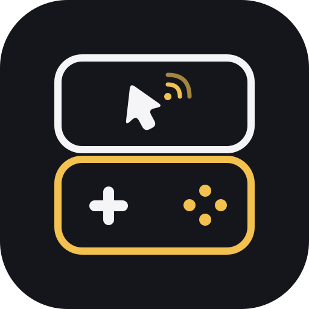
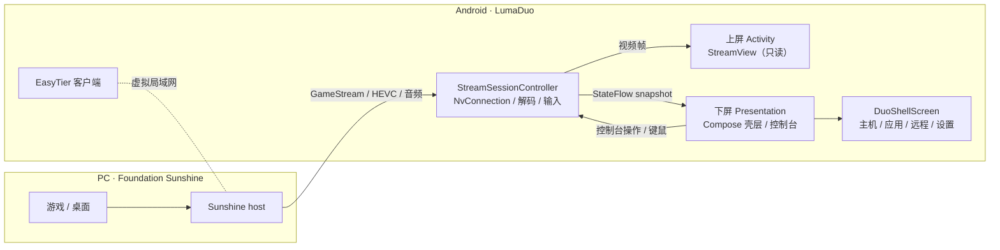

<div align="center">
  
  <h1>LumaDuo · 流明双屏</h1>
  <p><strong>为双屏安卓掌机打造的轻量 Moonlight 游戏串流客户端</strong></p>
  <p>Retroid Pocket Duo 首发 · AYN Thor 规划中</p>

  
  
  
  
</div>

---

LumaDuo（流明双屏）是一个面向双屏安卓掌机的 GameStream / Moonlight 客户端。它以上屏播放串流画面、下屏承载全部交互为核心：上屏只做视频与只读状态，主机、应用、远程网络、设置和串流控制台都在下屏完成。

项目从 [Moonlight V+](https://github.com/qiin2333/moonlight-vplus) 的 `nonRoot` 产品线 fork，但目标不是继续堆叠上游功能，而是**只保留串流引擎，把产品层完全收回自己手里**：更少的入口、更快的启动、更明确的双屏分工、没有遥测和多余服务。

> **当前状态：Alpha / 开发中。** RP Duo 上的启动、发现、配对、串流、直通/本地切换、退出/断开、5 页签控制台和工具态已通过真机验证。项目尚未发布 APK，release 仍未配置正式签名。

## 目录

- [为什么做 LumaDuo](#为什么做-lumaduo)
- [功能](#功能)
- [双屏模型](#双屏模型)
- [技术架构](#技术架构)
- [技术栈](#技术栈)
- [仓库结构](#仓库结构)
- [构建](#构建)
- [版本与产物](#版本与产物)
- [开发进度](#开发进度)
- [路线图](#路线图)
- [借鉴与参考](#借鉴与参考)
- [隐私与安全](#隐私与安全)
- [许可证](#许可证)
- [文档](#文档)

## 为什么做 LumaDuo

Moonlight V+ 是一个功能非常完整的串流客户端，但它的产品面是为普通单屏手机/平板设计的：主机列表、应用列表、设置树、游戏菜单、商店、触觉、USB 转发、帧生成、更新和遥测都在同一个应用里。到了 RP Duo 这类上下双屏设备上，这些功能既没有为下屏重新组织，也没有为上屏/下屏建立清晰的输入所有权。

LumaDuo 的做法是：

- **上游只保留引擎**：`NvConnection`、标准 MediaCodec 解码、音频、输入、配对、EasyTier、剪贴板。
- **产品层由 LumaDuo 自控**：`DuoMainActivity`、下屏 `Presentation` 壳层、串流控制台、设置、焦点和发布面。
- **V+ 旧产品面退出最小版**：`PcView` / `AppView` / `StreamSettings` / `GameMenu` / Crown / USB / PyroWave / framegen / 触觉 / 遥测 / 更新 / 小组件不进入 `duo` release 的产品入口。
- **不伪造数据**：主机负载不可用时显示“未提供”，实测码率没有样本时显示“—”，丢包没有数据源时显示“—”。

这不是一次性重写，而是“先隔离产品面，再抽引擎边界，最后删可选模块”的绞杀路线。Phase A/B/C/D1 已完成，D2 源码级清理待做。

## 功能

### 双屏

- 上屏 Activity 只负责 `StreamView` 和只读状态；所有可交互控件固定在下屏。
- 下屏使用 `Presentation` + Jetpack Compose，按 display-scoped context 得到正确的 640×480dp 布局。
- 下屏消失/恢复时回退或重建，不重建串流会话。
- 上屏浏览态会镜像下屏当前页面：主机地址/状态、应用首字母色块、EasyTier 网络图、设置分类与前 5 条当前值。

### 主机与应用

- 局域网自动发现、手动添加、PIN 配对、重新配对。
- 主机详情、在线状态、地址、配对状态。
- 真实应用列表与 Sunshine `appasset` box art；加载失败保留字母占位。
- 客户端 TCP 网络探测：47984 / 47989 / 47990，显示可达端口数与最小/平均连接耗时，不做主机认证、不伪造丢包。

### 串流控制台

下屏 5 个页签，状态置首并默认，只读：

| 页签 | 内容 |
|---|---|
| 状态 | STREAM HEALTH 头部、FPS/RTT/码率/延迟、本机温度/电量/Wi-Fi、60s 趋势、2×2 矩阵 |
| 画面 | 分辨率、帧率、主机屏幕模式、码率、自适应码率、渲染缩放、HDR |
| 音频 | 本机音量、静音、声道、音频直通、麦克风 |
| 输入 | 输入模式、触摸模式、触摸板速度、陀螺仪、震动 |
| 连接 | 主机/地址/配对状态、RTT、丢包与带宽、EasyTier、网络测试、重连、主机休眠 |

### 工具态

- **触摸板**：单指移动/点击、双指滚动、双指轻点右键、双击或长按切换拖拽锁定。
- **键盘**：ASCII 5 行 + 符号页 + 系统 IME；修饰键粘滞，离开工具/断流时释放所有按键。
- **快捷键**：12 个常用组合键 + 动作条；`Win+L`、主机休眠、退出串流均需二次确认。

### 远程网络

- EasyTier 配置卡：网络名、密钥（默认遮罩）、本机虚拟 IP、Peer、PC 虚拟 IP。
- 启动/停止/编辑、复制 PC 配置、配置二维码、手动添加。
- 状态卡：本机 ↔ EasyTier ↔ PC 连接图、节点、延迟；没有数据源的丢包显示“—”。
- PC 端不自动部署；用户自行安装 EasyTier 并导入配置。

### 设置

7 个一级分类：**画面 / 音频 / 输入 / 网络 / 主机 / 界面 / 关于**。一级页是直属选项行，复杂项收进各分类的“高级”子页。所有焦点控件可纯手柄到达，选中即预览、确认后调整、即时持久化。

### 隐私边界

- 无 Firebase、Crashlytics、分析 SDK 或任何遥测上传。
- 不做文件传输；不内置中继/穿透服务。
- 不请求 root；最小版移除 Shizuku、USB 驱动、相机、外部存储等权限。
- 配对 PIN、EasyTier `network_secret`、证书、token 不写入日志；UI 默认掩码。

## 双屏模型

RP Duo 的两块屏是同一 Android 设备上的两个 display：

| | 上屏 | 下屏 |
|---|---|---|
| 逻辑 display | 0 | 2（RP Duo） |
| 承载 | `Activity` + `StreamView` | `Presentation` + `ComposeView` |
| 尺寸 | 设备默认 | 1280×960 @320dpi = **640×480dp** |
| flags | — | `FLAG_PRESENTATION` |
| `canHostTasks` | true | **false** |
| 输入 | 串流直通时接收手柄/键鼠 | 本地模式下唯一焦点树 |

关键约束：

- 下屏 `canHostTasks=false`，不能 `am start --display 2` 启动 Activity；必须在默认屏启动 Activity，再查找下屏并 `Presentation.show()`。
- `Presentation` 必须自己提供 Lifecycle / ViewModelStore / SavedState / ActivityResult / OnBackPressedDispatcher 五个 owner。
- `ComposeView` 必须使用 display-scoped `context`，不能传 Activity context，否则会误用上屏 density，640×480dp 退化成 compact 布局。
- 串流默认 **直通**：输入事件交给 V+ 输入栈；Return/Back 或触摸下屏进入 **本地**，A 返回直通。窗口焦点通过 `FLAG_NOT_FOCUSABLE` 切换，避免双响应和卡键。

更完整的显示、焦点和踩坑记录见 [docs/DEVICE-MATRIX.md](docs/DEVICE-MATRIX.md)、[docs/INPUT-AND-FOCUS.md](docs/INPUT-AND-FOCUS.md) 和 [docs/ui/DUO-PITFALLS.md](docs/ui/DUO-PITFALLS.md)。

## 技术架构



### 产品层

| 组件 | 职责 |
|---|---|
| `DuoMainActivity` | 生产入口；上屏只读页、下屏 Presentation 生命周期、页面上下文同步 |
| `SecondScreenPresentation` | 下屏 Compose 宿主；5 个 owner、display context、Back 分发 |
| `DuoShellScreen` | 下屏壳层：Rail、AppBar、ModeBar、主机/应用/远程/设置导航 |
| `DuoHostRepository` | 绑定 `ComputerManagerService`，提供主机快照、应用列表、配对动作 |
| `DuoSettingsRepository` | 读写 `PreferenceConfiguration`，向设置页暴露真实值 |
| `DuoRemoteRepository` / `DuoRemoteController` | EasyTier TOML、VPN 启停、运行状态 |
| `DuoStreamConsole` | 串流 5 页签 + 工具态 |
| `DuoStreamToolkit` | 触摸板、ASCII 键盘、快捷键、确认层 |
| `Game` | 当前串流 Activity 宿主，持有 `NvConnection`、解码、音频、输入和 Presentation |

### 引擎边界

`StreamSessionController` 把产品层和 `Game` 解耦：

- `StreamSnapshot`：phase、主机/应用、分辨率、编码、HDR、实际 FPS、RTT、主机/解码/渲染延迟、码率、时长、notice。
- `StreamMetrics`：RTT 高低 32 位、带宽字符串解析，引擎和 UI 共用一份逻辑。
- 产品动作只依赖接口：`setConsoleMode`、`exitStream`、`reconnectStream`、`disconnectStream`、`unlockHost`、鼠标移动/按键/滚轮、`releaseAllInputs`。
- `Game` 在 `onCreate` / `prepareConnection` / `connectionStarted` / `onPerfUpdateWG` / `stopConnection` / `notifyDuoConnectionTerminated` 发布真实状态。
- 未知主机 CPU/GPU/内存/丢包保持 `null`，UI 显示“未提供”或“—”。

### 输入所有权

```text
HOME_LOCAL ──进入串流──> STREAM_PASSTHROUGH
     ▲                         │
     │                    Return / Back
     │                         ▼
     └──退出串流──── STREAM_LOCAL ──A/root──> STREAM_PASSTHROUGH
                              │
                          打开 panel
                              ▼
                           OVERLAY
```

- `STREAM_PASSTHROUGH`：事件交给 V+ `KeyboardInputHandler` / `TouchInputHandler`。
- `STREAM_LOCAL`：下屏 Compose 获得唯一焦点树；V+ 侧进入 `onExternalGameMenuOpened()`。
- 退出本地：`onExternalGameMenuDismissed()`，等待按键释放后恢复，避免残留按键。
- `OVERLAY`：确认层/浮层独占焦点，串流继续但输入暂停。

## 技术栈

| 层 | 选择 |
|---|---|
| 语言 | Kotlin（615 个文件）+ Java（21 个文件） |
| UI | Jetpack Compose + Material 3 |
| 串流引擎 | Moonlight V+ `nonRoot` / `NvConnection` / MoonBridge |
| 协议核心 | [moonlight-common-c](https://github.com/qiin2333/moonlight-common-c)（V+ `mic` 分支） |
| 解码 | Android MediaCodec（HEVC/H.264/AV1，按设备能力） |
| 音频 | SmartAudioRenderer / Android AudioTrack |
| 组网 | [EasyTier](https://github.com/EasyTier/EasyTier)（客户端内置 JNI） |
| 持久化 | SharedPreferences / `PreferenceConfiguration` |
| 二维码 | [ZXing Android Embedded](https://github.com/journeyapps/zxing-android-embedded) |
| 构建 | Gradle 9.4.1 / AGP / JDK 17 / compileSdk 36 / NDK 28.2 |

## 仓库结构

```text
LumaDuo/
├── app/
│   ├── src/main/java/com/sour/lumaduo/
│   │   ├── duo/          # 双屏宿主、Presentation、壳层、数据仓库
│   │   ├── stream/       # StreamSessionController、snapshot、metrics
│   │   ├── ui/           # Compose 主题、shell、stream console、toolkit
│   │   ├── computers/    # 主机发现/管理服务
│   │   ├── nvstream/     # NvConnection / 解码 / 音频
│   │   ├── binding/      # 手柄、键鼠、触摸输入
│   │   ├── preferences/  # 设置持久化
│   │   └── ...
│   ├── src/main/jni/     # moonlight-core JNI、OpenSSL/Opus 预编译库
│   ├── src/duo/          # 最小版 manifest overlay
│   ├── src/full/         # full edition 专用 assets
│   └── src/test/         # 222 个 JVM 测试文件
├── docs/                 # 产品、架构、UI 规格、真机记录、HTML 原型
├── design/               # 图标源文件、生成脚本、许可证说明
├── framegen/             # full edition 帧生成模块（duo 不打包）
├── pyrowave-runtime/     # full edition Vulkan 解码运行时
├── usbip-backend/        # full edition USB/IP 后端
├── gradle/               # version catalog + wrapper
└── settings.gradle
```

## 构建

完整工具链、代理、安装和双屏调试命令见 [docs/BUILDING.md](docs/BUILDING.md)。最短路径：

### 1. 准备

- JDK 17
- Android SDK 36 / Build Tools 36.0.0
- NDK 28.2.13676358 / CMake 3.22.1
- `audio-haptics` SDK（当前是全局 Gradle 依赖）

```bash
git clone --recurse-submodules <repository-url> luma-duo
cd luma-duo

git clone https://github.com/AlkaidLab/moonlight-audio-haptics.git ../moonlight-audio-haptics
git -C ../moonlight-audio-haptics checkout b3f97c3bb7500ea7b1985aea568e5c7b40308d3b
```

`local.properties`：

```properties
sdk.dir=/path/to/Android/Sdk
audioHapticsSdkDir=/path/to/moonlight-audio-haptics
```

### 2. 构建

```bash
./gradlew :app:assembleDuoDebug
./gradlew :app:assembleDuoRelease
./gradlew :app:testDuoDebugUnitTest :app:lintDuoDebug
```

### 3. 安装

```bash
adb install -r -d app/build/outputs/apk/duo/debug/app-duo-debug.apk
adb shell am start -W -a android.intent.action.MAIN \
  -c android.intent.category.LAUNCHER \
  -n com.sour.lumaduo.debug/com.sour.lumaduo.LauncherSaba
```

## 版本与产物

| 变体 | applicationId | 说明 | ABI |
|---|---|---|---|
| `duoDebug` | `com.sour.lumaduo.debug` | 双屏产品调试包 | arm64-v8a |
| `duoRelease` | `com.sour.lumaduo` | 正式产品包，当前**未签名** | arm64-v8a |
| `nonRootRelease` | `com.sour.lumaduo.full` | V+ 全量产品面对照/调试 | arm64-v8a, armeabi-v7a |
| `rootRelease` | `com.sour.lumaduo.root` | root 构建对照 | arm64-v8a, armeabi-v7a |

2026-11-21 构建记录（`67c95e90`）：

| 产物 | 大小 | SHA-256 |
|---|---:|---|
| `duoDebug` | 37,343,599 B | `a378f072d3b3730c04d5dac79a7b0385dd75833affca2300f9f426cc1fbdc7e4` |
| `duoRelease` | **16,455,976 B（16.46 MB）** | `cce63defc7138c03f00bbb84633ae6f4a8c5b6b1493f624fc739ed7873e8884e` |
| `nonRootRelease` | 26,370,119 B | `1f9a5d9e039ba627154e4308e9dd7fe34ff092bc61f8aa4a1f6aa4efd0673316` |

`duoRelease` 比原 V+ release 的 29.60 MB 减少 44.4%。主要体积来自 EasyTier 两个 native 库（压缩后约 9.1 MB）和 `libmoonlight-core.so`（2.93 MB）；framegen、USBIP、haptics、iperf3、`libc++_shared` 已从 duo 包中移除。

> 这些数字是本地构建记录，不是发布包。仓库不提供 APK 下载，也没有创建 GitHub Release。

## 开发进度

### 里程碑

| 阶段 | 内容 | 状态 |
|---|---|---|
| M0a | 未修改 V+ baseline 构建 | ✅ |
| M0b | RP Duo + Foundation Sunshine 真实串流 | ✅ |
| M0.5 | 双屏探针：display/Presentation/焦点/输入 | ✅ |
| M1 | 全面改包名（JNI/FindClass/Manifest/ProGuard） | ✅ |
| M2 | Lumen Gold 壳层、主机/应用/远程/设置真实数据 | ✅ |
| M3 | 上屏视频 + 下屏 5 页签控制台 + 工具态 | ✅ |
| Phase A | 最小 `duo` 变体、最小 manifest、locale/resource shrink | ✅ |
| Phase B | `StreamSessionController` 引擎边界 | ✅ |
| Phase C | 删除 Firebase/Crown/USB/触觉/framegen 产品路径 | ✅ |
| Phase D1 | `duo` 接管正式包名与升级路径 | ✅ |
| Phase D2 | 删除 legacy 源码、full edition、可选编译依赖 | ⏳ |
| M4 | EasyTier 端到端、实体手柄/键盘、长时稳定性 | 🚧 |
| M5 | 签名、GPL 审计、发布 | ⏳ |

### 已真机验证（RP Duo / Android 16）

- 冷启动 `DuoMainActivity`，无 `UnsatisfiedLinkError` / `NoClassDefFoundError`。
- 发现并配对 Foundation Sunshine，配对数据持久化。
- 应用列表读取真实应用，加载真实 box art。
- Desktop 串流：上屏 1920×1080 60Hz，下屏显示 59–60 FPS、3–4 ms RTT、Wi-Fi、电量/温度。
- 下屏 640×480dp 布局；状态页、设置、远程页、主机页逐项截屏核对。
- 触摸下屏进入本地，A 返回直通；退出/断开回到壳层，无崩溃、无卡键残留。
- 连接页 TCP 网络测试 3/3 端口，最低 2–3 ms、平均 4–10 ms。
- 控制台 5 页签接真实设置；工具态触摸板/键盘/快捷键可用；`Win+L`/休眠/退出有二次确认。
- 上屏浏览态按主机/应用/远程/设置分类同步。
- Presentation 退出 lifecycle 崩溃已修复；主机 Sunshine 从 `ensure_only_display` 改为 `ensure_active`，避免异常会话后物理屏黑屏。

### 尚未验证 / 未完成

- 实体手柄全键位、HAT/摇杆/扳机、直通/本地切换。
- 实体键盘与 12 个快捷键到主机；断流/切模式无卡修饰键。
- EasyTier 实际隧道：VPN 授权、虚拟 IP、启动/停止。
- 30 分钟以上长时串流、温度/掉帧/内存。
- 断流重连、主机睡眠/唤醒、显示热插拔、下屏被占用。
- 音频输出/声道/麦克风实际听感。
- 538×469 窄屏与 AYN Thor（当前无设备）。
- release 签名、GPL/NOTICE 完整审计。
- 单屏模式、PiP、QR 扫码、Sunshine WebUI、主机实时负载按决策延期。

## 路线图

### P0 · 稳定性收口

1. 实体手柄全键位与直通/本地切换。
2. 实体键盘、修饰键、快捷键与断流释放。
3. EasyTier 端到端隧道。
4. ≥30 分钟长时串流与断流/重连。
5. 主机显示安全：保持 `ensure_active`，记录异常恢复步骤。

### P1 · 产品打磨

- 清理画面/音频页占位，明确“可用 / 需重连 / 隐藏”。
- PIN、IP、EasyTier 表单支持纯手柄 ASCII 输入。
- 主机/应用操作语义完善：运行中游戏退出/切换、应用详情。
- 连接页网络测试、EasyTier、RTT/丢包文案统一。
- 最小版只保留真实可用设置项。

### P2 · 代码清理

- D2：拆共享模型后删除 `PcView` / `AppView` / `StreamSettings` / `GameMenu`。
- full edition 退场，删除 `nonRoot` / `root` 产品面。
- 移除 audio-haptics / framegen / usbip / pyrowave 编译依赖与对应 JNI。
- 正式签名、CI、GPL/NOTICE 审计、升级路径。

延期、不排期：单屏模式、PiP、QR 扫码、Thor 适配、Host Bridge、Sunshine WebUI、文件传输（原本就不做）。

## 借鉴与参考

LumaDuo 站在这些项目的肩膀上：

| 项目 | 许可证 | 用途 |
|---|---|---|
| [Moonlight V+](https://github.com/qiin2333/moonlight-vplus) | GPL-3.0 | Android 串流客户端底座；保留 `NvConnection`、MediaCodec、音频、输入、配对、EasyTier、剪贴板 |
| [Moonlight Android](https://github.com/moonlight-stream/moonlight-android) | GPL-3.0 | V+ 的上游；Moonlight 协议与 Android 客户端实现 |
| [moonlight-common-c](https://github.com/qiin2333/moonlight-common-c) | GPL-3.0 | GameStream 协议核心（V+ `mic` 分支） |
| [Foundation Sunshine](https://github.com/AlkaidLab/foundation-sunshine) | GPL-3.0 | PC 主机端；不随客户端打包 |
| [Sunshine](https://github.com/LizardByte/Sunshine) | GPL-3.0 | Foundation Sunshine 的上游 |
| [EasyTier](https://github.com/EasyTier/EasyTier) | LGPL-3.0 | 远程虚拟局域网；客户端通过 JNI 使用 |
| [moonlight-audio-haptics](https://github.com/AlkaidLab/moonlight-audio-haptics) | Apache-2.0 | V+ 构建依赖；duo 不打包其 native 产物 |
| [LSFG-VK Android Legacy](https://github.com/AlkaidLab/lsfg-vk-android-legacy) | — | full edition 帧生成，duo 不打包 |
| [PyroWave](https://github.com/AlkaidLab/pyrowave) | — | full edition Vulkan 解码，duo 不打包 |
| bili-duo（yearzen1） | MIT | 双屏布局、焦点环、Rail、ModeBar 与设计语言参考 |
| UUYC-Duo / DuoRemote | GPL-3.0 | A1 双屏手柄图标几何；LumaDuo 重着色为 Lumen Gold |
| [Jetpack Compose](https://developer.android.com/jetpack/compose) | Apache-2.0 | 下屏 UI |
| [ZXing Android Embedded](https://github.com/journeyapps/zxing-android-embedded) | Apache-2.0 | PC 配置二维码 |

LumaDuo 与上述公司/项目无隶属关系。没有打包 Bilibili、AYN/Retroid、NVIDIA、Moonlight、Sunshine、网易 UU 或 UUYC 的品牌素材。

## 隐私与安全

- **无遥测**：没有 Firebase、Crashlytics、分析 SDK、更新检查或后台上报。
- **不存主机凭据**：配对证书只用于 Moonlight 会话；Sunshine Web UI 需要独立认证，MVP 不要求用户把管理员密码存到掌机。
- **密钥掩码**：EasyTier `network_secret` 默认遮罩，不写日志；复制/二维码前提示。
- **最小权限**：`duo` 移除相机、外部存储、`MANAGE_EXTERNAL_STORAGE`、`WRITE_SECURE_SETTINGS`、安装包、Shizuku、USB 驱动等权限。
- **截图不入库**：真机调试截图可能包含主机名、局域网地址和配对信息，统一排除在仓库之外。
- **漏洞报告**：请不要公开提交安全 Issue；使用 GitHub Security Advisory 或维护者私密渠道。详见 [SECURITY.md](SECURITY.md)。

日志、截图和 Issue 中不要出现：配对 PIN、EasyTier 密钥、设备证书/私钥、账号 token/Cookie、完整公网地址。

## 许可证

LumaDuo 以 **GNU General Public License v3.0** 发布，见 [LICENSE](LICENSE)。

分发 APK 或二进制时，必须同时提供完整对应源码，并保留：

- [LICENSE](LICENSE)
- [NOTICE](NOTICE)
- [design/icons/uuyc-a1/NOTICE.txt](design/icons/uuyc-a1/NOTICE.txt)
- 上游 GPL/Apache/LGPL 许可证与版权声明

第三方来源、商标边界和分发清单见 [docs/LEGAL.md](docs/LEGAL.md)。

## 文档

- [文档索引](docs/README.md)
- [产品定位与 MVP 边界](docs/PRODUCT.md)
- [技术架构](docs/ARCHITECTURE.md)
- [双屏设备矩阵](docs/DEVICE-MATRIX.md)
- [RP Duo 平台开发参考](docs/RP-DUO-DEV.md)
- [输入与焦点](docs/INPUT-AND-FOCUS.md)
- [串流控制台](docs/STREAM-CONSOLE.md)
- [最小可控版与瘦身记录](docs/MINIMAL-EDITION.md)
- [构建、安装与调试](docs/BUILDING.md)
- [测试策略与真机记录](docs/TESTING.md)
- [UI 设计系统](docs/ui/DESIGN-SYSTEM.md)
- [页面规格](docs/ui/SCREEN-SPEC.md)
- [可点击 HTML 原型](docs/ui/prototype/index.html)
- [决策记录](docs/DECISIONS.md)
- [路线图](docs/ROADMAP.md)

> 文档中的“已验证”均指 RP Duo / Android 16 真机；Thor、单屏、PiP 和 EasyTier 实际隧道尚未验证，不作为当前发布门槛。
